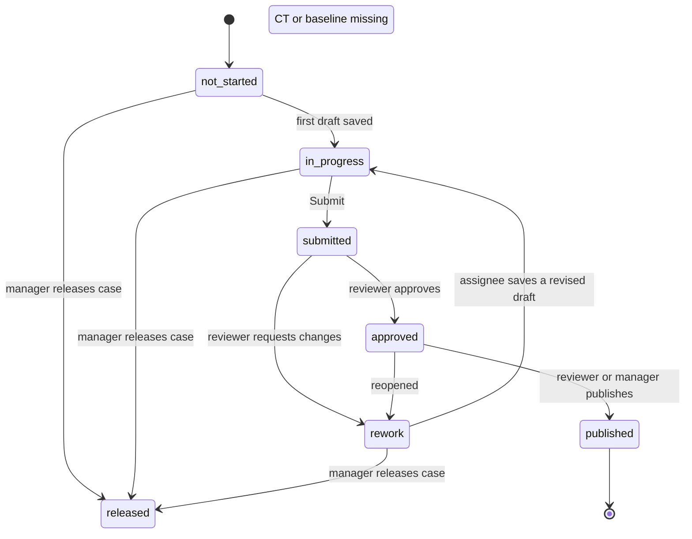

# Annotation projects: assignment, draft, review, publish

Status: the v1 workflow is implemented and committed locally on `feature/annotation-projects` (`055aa775`). The feature remains disabled by default. It is not approved for production rollout: deployment, storage/retention policy, and a real multi-annotator pilot still need to be completed. This document preserves the original design and calls out the remaining operational limits below.

Purpose: let a manager divide a cohort among many radiologists, give each radiologist a private working copy, review submissions, and publish approved corrections into the scan's canonical mask without any annotator being able to overwrite another's work.

## 1. Why this exists

The next annotation effort is multi-reader: roughly 50 radiologists annotate veins, arteries, ducts and lesions on assigned case ranges (for example PanTS 55–95 to one radiologist and 145–200 to another). The website currently has no assignment, worklist, per-user draft or review concept. Access is granted per person, but the unit of work is still the whole scan and the whole scan's single shared mask.

Without a workflow layer, the failure modes are predictable:

- Two radiologists editing the same scan overwrite each other; the last save wins.
- Work in progress exists only in the browser until it is published, so a closed tab loses it.
- There is no record of who annotated which case, which version was reviewed, or who approved it.
- Progress is unobservable without asking people.
- A correction to one structure can silently replace every other structure on the scan.

## 2. Current behaviour (verified)

These are properties of the code when this proposal was written, not a description of the current feature branch.

### 2.1 Accounts and roles

- Roles are `admin`, `annotator` and `annotation_manager` (`flask-server/services/role_store.py`). `annotator` may replace a dataset scan's shared mask; `annotation_manager` is the only role that may grant or withdraw `annotator`, and it can only be granted on the server with `flask-server/scripts/grant_role.py`.
- Accounts are created by email sign-up; single-use `annotator` invitations are issued by a manager from Settings → People (`flask-server/models/annotator_invite.py`, `flask-server/api/admin_blueprint.py`, `PanTS-Demo/src/routes/Settings/AnnotatorCodes.tsx`).

### 2.2 One mask per dataset scan

A dataset scan (`PanTS_########`, `CV_########`, `BDMAP_########`) has exactly one mask that every viewer sees:

- `save_segmentation_shared` (`flask-server/api/api_blueprint.py`) writes `edits/shared/<CASE_KEY>/combined_labels.nii.gz` and archives the version it replaces.
- Private saves are refused for dataset scans: `_save_segmentation_locked` returns 403 directing the caller to "Save to JHU server" (`flask-server/api/api_blueprint.py`).
- `_pants_viewer_mask_path` resolves PanTS masks as shared edit → local dataset → Hugging Face mirror. `_cancerverse_mask` and `_abdomenatlas_mask` also prefer `shared_annotations.existing_shared_mask` before their built overlay mask.
- The browser save path resolves through `_case_mask_path`, which is PanTS-shaped; whether CancerVerse and AbdomenAtlas can currently persist a shared mask from the UI needs verification before relying on it.

Revision checks (`If-Match`) protect a tab that opened an older version, but they do not stop two users from overwriting each other in sequence. There is no claim, lease, draft or review step.

### 2.3 Labels

- The viewer numbering is 1–44 (`flask-server/services/label_scheme.py`; mirrored in `PanTS-Demo/src/helpers/constants.ts`). Relevant targets already exist: common bile duct 7, pancreatic duct 21, lesion 22, superior mesenteric artery 26, veins 28, renal veins 30/31, and lesion types 33–44.
- Custom structures are names and colours stored inside the saved NIfTI, indexed 1–255 (`flask-server/services/segmentation_metadata.py`). Indices 1–44 rename existing viewer labels; higher indices can be additional structures.
- A project that names custom structures must pin both index and name, because the metadata can be edited later.

### 2.4 Original gap addressed by this feature

The implementation now provides projects and assignments, worklists, private per-assignment drafts for dataset scans, submit/review/rework states, target-structure-only publishing, progress and CSV export, and account-attributed audit history. Those capabilities were missing when this proposal was written. The remaining gaps are operational validation and rollout work, not missing core workflow screens: no real multi-radiologist pilot has been run, storage retention/orphan cleanup is intentionally deferred pending an approved policy, and real CancerVerse/AbdomenAtlas overlay cases still need verification.

## 3. Goals and non-goals

Goals:

- A manager defines projects and assignments from typed ranges, pasted lists or CSV, and sees which case IDs matched before anything is written.
- A radiologist signs in, sees only their own assignments, and saves drafts that no other account can see or overwrite.
- Submitting freezes a version; a named reviewer approves or requests rework; only approved work can be published.
- Publishing replaces only the project's target structures; every other structure on the scan survives.
- Every state change and publish is attributable to an account, time and mask revision.
- Unassigned scans keep today's behaviour exactly.

Non-goals for v1:

- Dual independent reading and adjudication of two readers.
- AI-generated drafts at assignment creation (batch-specified annotation recipes, precomputed nnInteractive drafts).
- Automated deadlines, reminders and scheduling.
- DICOM ingest; radiologists work with the site's NIfTI volumes.
- Uploaded or session scans; they need a "project scan" concept and are deferred.
- Clinical use. This remains a research annotation tool, consistent with the site's non-clinical scope.

## 4. Vocabulary

| Term | Meaning |
| --- | --- |
| Project | The unit a manager creates: one scan source, one target structure set, one baseline rule, one named reviewer, one due date. This is the Canvas "course". |
| Assignment | One radiologist's worklist inside a project: a case selector plus an optional target override. This is the Canvas "assignment". |
| Case row | One scan inside one assignment, carrying the workflow state and draft revision. |
| Submission | An immutable snapshot frozen when the radiologist presses Submit. |
| Review | Approve, request rework, or edit (which creates a new submission version). |
| Publish | Merge the approved submission's target structures into the scan's canonical mask. |
| Reviewer | An account named on one project; may review and publish only that project. |
| Manager | An account with `annotation_manager`; may review and publish any project. |

## 5. Domain model

All IDs are UUID strings. Timestamps are UTC. Target sets and case selectors are JSON. No existing table changes.

### 5.1 `annotation_project`

| Column | Type | Notes |
| --- | --- | --- |
| `id` | text PK | |
| `name` | text, not null | |
| `description` | text, null | |
| `scan_source` | text, not null | `pants`, `cancerverse` or `abdomenatlas`; one source per project |
| `target_labels` | JSON, not null | viewer label indices, 1–255 |
| `target_names` | JSON, not null | index → name snapshot, for custom structures and drift detection |
| `baseline_mode` | text, not null | `canonical`, `seed` or `empty` |
| `seed_dir` | text, null | server-side directory; only when `baseline_mode = seed` |
| `reviewer_id` | text, null FK `user_account.id` ON DELETE SET NULL | named reviewer |
| `created_by` | text, null FK ON DELETE SET NULL | |
| `created_at` | datetime, not null | |
| `due_at` | datetime, null | informational in v1 |
| `closed_at` | datetime, null | |
| `status` | text, not null | `open` or `closed` |

### 5.2 `annotation_assignment`

| Column | Type | Notes |
| --- | --- | --- |
| `id` | text PK | |
| `project_id` | text, not null FK `annotation_project.id` ON DELETE CASCADE | |
| `assignee_id` | text, null FK `user_account.id` ON DELETE SET NULL | null means needs reassignment |
| `case_selector` | JSON, not null | `{ranges: [{from, to}], ids: [string], exclude: [string]}` |
| `target_labels` | JSON, null | override; null inherits the project |
| `status` | text, not null | `open`, `closed` |
| `note` | text, null | shown on the worklist card |
| `created_by` | text, null FK ON DELETE SET NULL | |
| `created_at` | datetime, not null | |
| `due_at` | datetime, null | |

### 5.3 `annotation_case`

| Column | Type | Notes |
| --- | --- | --- |
| `id` | text PK | |
| `assignment_id` | text, not null FK ON DELETE CASCADE | |
| `case_key` | text, not null | canonical folder id, e.g. `PanTS_00000055` |
| `status` | text, not null | see section 6 |
| `draft_revision` | text, null | content hash or server revision of the draft |
| `current_submission_id` | text, null FK `annotation_submission.id` ON DELETE SET NULL | |
| `created_at`, `updated_at`, `last_activity_at` | datetime, not null | |

Unique `(assignment_id, case_key)`.

### 5.4 `annotation_submission`

| Column | Type | Notes |
| --- | --- | --- |
| `id` | text PK | |
| `case_row_id` | text, not null FK `annotation_case.id` ON DELETE CASCADE | |
| `assignment_id` | text, not null FK | denormalised for review queries |
| `version` | integer, not null | 1, 2, … per case row |
| `submitted_by` | text, null FK ON DELETE SET NULL | |
| `submitted_by_name` | text, not null | snapshot, survives account deletion |
| `submitted_at` | datetime, not null | |
| `note` | text, null | radiologist's note to the reviewer |
| `mask_low_path`, `mask_full_path` | text, not null | server-written |
| `mask_revision` | text, not null | hash of the submitted mask |
| `status` | text, not null | `in_review`, `rework`, `approved`, `published` |
| `reviewer_id` | text, null FK ON DELETE SET NULL | |
| `reviewed_at`, `review_note` | datetime/text, null | |
| `published_at`, `published_by` | datetime/text, null | |

Unique `(case_row_id, version)`. A submitted row is never updated except for review and publish fields and status transitions.

### 5.5 `annotation_review_event`

| Column | Type | Notes |
| --- | --- | --- |
| `id` | text PK | |
| `project_id`, `assignment_id`, `case_row_id` | text, not null | |
| `submission_id` | text, null | |
| `actor_id` | text, null FK ON DELETE SET NULL | |
| `actor_name` | text, not null | snapshot |
| `action` | text, not null | `create_project`, `assign`, `draft`, `submit`, `approve`, `rework`, `edit`, `publish`, `reassign`, `close` |
| `comment` | text, null | |
| `created_at` | datetime, not null | |
| `details` | JSON, null | revisions, case keys, prior status |

Append-only. No update or delete route.

### 5.6 Invariants

1. One active assignment per `(case_key, target label)`. Creating an intersecting assignment is refused unless an explicit manager override is added later; v1 has no override.
2. Target labels are integers 1–255; names are snapshotted. A name change in the mask metadata is reported, not silently accepted.
3. A submission is immutable. Reviewer edits create a new version attributed to the reviewer.
4. Only an `approved` submission can be published.
5. Publishing changes only the target labels.
6. Projects are closed, never deleted, while submissions exist. Closing stops new drafts and submissions but keeps review and publish of existing work.
7. Case keys are normalised with the same rule as `_shared_case_key` (`PanTS`, `CV`, `BDMAP`, eight-digit padding); `55` and `PanTS_00000055` are the same case.

## 6. Workflow



| Transition | Actor | Condition |
| --- | --- | --- |
| `not_started → in_progress` | assignee | first successful draft save; project open |
| `in_progress → submitted` | assignee | draft exists; project open; one request |
| `submitted → approved` | named reviewer or manager | submission's target labels reviewed |
| `submitted → rework` | named reviewer or manager | comment optional but recommended |
| `rework → in_progress` | assignee | saving a draft after rework |
| `approved → published` | named reviewer or manager | canonical merge succeeded |
| `approved → rework` | named reviewer or manager | reviewer reopens before publish |
| `not_started`, `in_progress`, or `rework` → `released` | manager | explicit release; draft and review history are retained, case is read-only |
| any → `unavailable` | system, at assignment creation only | CT or baseline cannot be resolved |

Any other transition returns 409 and changes nothing. Progress is derived from these states.

## 7. Baseline resolution

When an assignee opens a case, the server resolves the mask in this order:

1. The assignee's draft, if one exists.
2. The case's latest submission, when it is `submitted`, `approved` or `published`; these states are read-only for the assignee. A case returned for `rework` opens its editable draft and shows the reviewer feedback.
3. The project baseline:
   - `canonical`: the mask the public viewer currently shows (shared edit for PanTS/CancerVerse/AbdomenAtlas, else the built or source mask), with source-to-viewer conversion exactly as readers already do.
   - `seed`: a manager-uploaded mask for this case, validated against the case ID and CT geometry.
   - `empty`: an all-zero uint8 mask on the CT grid, using the existing blank-mask helper.

For a reviewer, the submission snapshot is served directly; a reviewer never sees the assignee's draft.

`seed` upload: before creating assignments, a manager uploads one ZIP of NIfTI files. Each filename identifies a case in the project's dataset; the server rejects paths, duplicates, missing CTs and geometry mismatches. The seed set cannot be replaced after upload. Files are copied into the project's seed directory; the ZIP is not retained. Assignment previews select from these validated seeds.

## 8. Storage and retention

```
<PANTS_VIEWER_LABEL_CACHE_PATH>/edits/
  shared/<CASE_KEY>/                      # canonical, existing
    combined_labels.nii.gz
    combined_labels_lowres.nii.gz
    meta.json
    history/<timestamp>.nii.gz
  assignments/<project_id>/
    seed/<CASE_KEY>.nii.gz
    <assignment_id>/<case_row_id>/
      drafts/<sha256>.nii.gz
      submissions/<submission_id>/
        combined_labels.nii.gz
```

Rules:

- All paths are built from server IDs and normalised case keys; no client string becomes a path component.
- Drafts and submissions are never written into `edits/shared/`. Only publish writes there.
- Writes are atomic: temporary file or directory, then rename. A crash leaves the previous version intact.
- The current implementation stores content-addressed draft revisions and points the database at the latest one. Older draft objects are not yet removed; storage usage must be measured and a safe retention policy implemented before a large rollout.
- The project storage measurement reports total bytes alongside noncurrent draft files and submission files not referenced by a database submission. These are informational counts, not evidence that files can safely be deleted; the scan does not remove anything.
- Keep all immutable submission versions indefinitely for the first round. Retention and deletion require a separately approved policy.
- Drafts and submissions require a full-resolution mask on the CT grid; low-resolution masks are derived previews, never the authoritative source. Measure `du` on a pilot project before opening 50 accounts; set a disk alert at the deployment level.
- A crash between file rename and DB commit can leave an unreferenced submission directory. Automated orphan cleanup is not implemented yet; do not assume those files are removed after seven days.
- Transferring unfinished cases copies the current draft to the new assignment and retains old files and submission snapshots; historical review events remain attributed to the original assignment. The operation does not perform cleanup.

## 9. Publish and merge

Publishing is the only operation that changes what the public viewer sees.

1. Authorise: submission is `approved`; caller is the project reviewer or a manager; submission not already published. A closed project still allows review and publish of work already submitted.
2. Take the canonical case lock used by `save_segmentation_shared` (`services/segmentation_save_lock.py`).
3. Read the current canonical mask as the base. If none exists, use the same source mask the public viewer resolves.
4. For each target label index `L`:
   - Take `L`'s voxels from the submission (an empty `L` means the structure was cleared).
   - If the submission grid differs from the base grid, resample only `L` with nearest-neighbour onto the base grid.
   - Replace `L` in the base.
5. Non-target labels are copied from the base and never from the submission.
   If a proposed target voxel overlaps a non-target label in the current base,
   reject the publish with 409; a single-label volume cannot preserve both.
6. Archive the base with `_archive_shared_version`.
7. Write the merged mask atomically; write low-res preview when the existing pipeline expects it.
8. Update `meta.json`: increment version, store revision, `saved_by`, time, `project_id`, `assignment_id`, `submission_id`.
9. Mark the submission `published`, the case `published`, and append a review event.
10. Invalidate the case's metrics and mesh caches using the existing revision checks.

Additional rules:

- Idempotence: publishing an already published submission returns success without another merge; the meta and event are not duplicated.
- Republish for rollback: a manager may publish an older approved submission. It creates a new canonical version with the older content for the target labels, which is the targeted rollback path. The existing "revert shared annotation" route remains available for removing the override entirely.
- A rollback requires the current shared revision and a client-generated UUID operation ID. Retrying with the same ID finishes an interrupted publish without creating a second revision; an unresolved recovery marker blocks other publishes and shared saves. The assignment must be finished and conflicting active assignments are refused.
- If the target labels of two projects intersect on the same case, the assignment guard should have prevented it. If historical data violates this, publish returns 409 and asks the manager to reconcile; it never guesses.
- Custom structure names: publishing preserves existing structure metadata and adds the project's pinned name for a previously unnamed custom target. If an existing name differs, the save or publish is refused for reconciliation.

## 10. HTTP API

All routes are under `<BASE_PATH>/api` and require authentication unless stated. Bodies are JSON except masks and drafts, which use the existing gzip uint8 format.

Capabilities and worklist:

| Method | Path | Who | Purpose |
| --- | --- | --- | --- |
| GET | `/annotation-projects/capabilities` | any | `{enabled, can_manage, can_review}`; UI hides the feature when disabled |
| GET | `/me/assignments` | any signed-in | own assignments with progress counters |
| GET | `/assignments/<assignment_id>/cases` | assignee, reviewer, manager | case list and statuses |
| GET | `/assignments/<assignment_id>/cases/<case_key>` | assignee, reviewer, manager | assignment context: project, targets, state, baseline, draft revision, actions allowed |

Manager:

| Method | Path | Purpose |
| --- | --- | --- |
| POST | `/projects` | create a project |
| GET | `/projects` | projects visible to the caller |
| GET, PATCH | `/projects/<project_id>` | read; rename, change reviewer, close |
| POST | `/projects/<project_id>/assignments` | range/list creation; `dry_run=true` returns matched and missing case IDs |
| GET | `/projects/<project_id>/assignments` | assignments and counts |
| PATCH | `/assignments/<assignment_id>` | transfer the entire assignment or change instructions and due date |
| POST | `/assignments/<assignment_id>/transfer-unfinished` | transfer editable cases and drafts to a new assignment; retain submitted, approved and published cases |
| POST | `/assignments/<assignment_id>/cases/<case_key>/release` | manager releases an unfinished editable case without deleting its draft or history |
| POST | `/projects/<project_id>/seed` | multipart ZIP upload |
| GET | `/projects/<project_id>/progress` | per radiologist and per case state counts |
| GET | `/projects/<project_id>/export.csv` | assignment and progress export |
| POST | `/projects/<project_id>/close` | close project |

Radiologist:

| Method | Path | Purpose |
| --- | --- | --- |
| POST | `/assignments/<assignment_id>/cases/<case_key>/draft` | save draft; `If-Match` draft revision; returns new revision |
| POST | `/assignments/<assignment_id>/cases/<case_key>/submit` | freeze a submission |
| GET | `/get-segmentations/<case_key>.nii.gz?assignment=<id>` | assignment-aware mask load |
| POST | `/mask-data` with form field `assignment=<id>` | organ statistics computed from the same resolved mask (draft, baseline or submission) |

Reviewer:

| Method | Path | Purpose |
| --- | --- | --- |
| GET | `/reviews?project=<id>&status=in_review` | queue |
| GET | `/submissions/<submission_id>` | metadata and history |
| GET | `/get-segmentations/<case_key>.nii.gz?submission=<id>` | frozen submission mask |
| POST | `/submissions/<submission_id>/approve` | approve |
| POST | `/submissions/<submission_id>/rework` | request changes with a comment; optionally create a reviewer-authored new version |
| POST | `/submissions/<submission_id>/publish` | merge into canonical |
| GET | `/cases/<case_key>/annotation-history` | all projects, submissions and events for a case |

Bypass guard: `POST /save-segmentation-shared` and `DELETE /shared-annotation/<case>` return 409 while the case has an active project, directing the caller to the workflow. `annotation_manager` accounts may still act on unassigned scans exactly as today.

Error rules: 401 unauthenticated, 403 non-member, 404 unknown assignment or case for non-members (avoids enumeration), 409 stale revision or invalid state transition, 507 disk full.

## 11. Viewer integration

- `PanTS-Demo/src/helpers/segmentationSource.ts` appends `assignment` or `submission` to the mask URL when the viewer is opened from the worklist.
- `PanTS-Demo/src/routes/VisualizationPage.tsx` reads the context, renders the banner, restricts editing to the assigned structures, and calls the draft/submit endpoints instead of the shared save.
- `PanTS-Demo/src/helpers/CornerstoneNifti2.tsx` gains a save mode: `private` (existing sessions), `shared` (existing unassigned behaviour), `draft` and `submit`. The payload format is unchanged.
- `get_segmentations` must honour the parameters for `HEAD` as well as `GET`; the frontend already uses `HEAD` to test mask availability.
- Assignment mode must not show a 3D mesh or report generated from an unpublished draft. v1 shows the canonical 3D mesh labelled as the published version, or hides 3D for target structures; reports are disabled in assignment mode with a clear note. Per-draft meshes and reports are a later extension.
- `/mask-data` in assignment mode resolves the same mask as the viewer, so volume statistics never describe a different mask from the one on screen.
- The existing interactive segmentation panel is unchanged and writes into the draft.

## 12. User interface

Radiologist:

- `/work`: assignment cards with project, structures, case count, due date, progress and a "next unfinished case" action.
- Case list with status chips: not started, in progress, submitted, rework, approved, published, unavailable.
- Viewer banner: project, assigned structures, status, **Save draft**, **Submit for review**. After submit the case is read-only until rework.
- Segment panel: assigned structures highlighted; other structures read-only; a "show all" toggle remains.
- A short onboarding tour reuses the existing `WorkspaceTour` component.

Reviewer:

- Review queue scoped to the project, grouped by radiologist.
- Open submission → approve, request rework with a comment, or edit (new submission version) → publish.
- Review notes are visible to the radiologist on the case.
- When requesting rework, a reviewer can explicitly request a generic email to the assignee. It includes no case ID or review text. The result distinguishes SMTP acceptance from an unavailable or failed send; delivery is not guaranteed and the review state is saved regardless.

Manager:

- Settings → Annotation projects, alongside People and Annotator codes. The existing Settings rail adds admin sections only for `admin` (`PanTS-Demo/src/routes/Settings/index.tsx`, `ADMIN_SECTIONS`); add this section for `annotation_manager` accounts as well, and have the route and the APIs check the role independently of the navigation.
- Create a project: source, targets (global labels plus custom indices), baseline, reviewer, due date.
- Add assignments by typing ranges, pasting a list, or uploading CSV. A dry run shows matched and missing IDs before writing.
- Roster import: paste addresses or load a one-address-per-row text/CSV file to create separate invite codes through the existing invitation system. Addresses label the displayed list only: codes are not bound to accounts, no email is sent, and codes cannot be recovered after leaving the page. A connection failure can leave a created code undisplayed; check recent codes before retrying.
- Progress table per radiologist and per case; export CSV; reassign unfinished cases; close the project.

All UI strings must make clear that this is research annotation, not a clinical workflow.

## 13. Permissions and onboarding

| Action | Assignee | Reviewer (own project) | `annotation_manager` | Admin (not manager) | Anonymous |
| --- | --- | --- | --- | --- | --- |
| See own worklist | yes | yes | yes | no | no |
| See another assignment | no | yes | yes | no | no |
| Save draft on own case | yes | no (own assignment) | no | no | no |
| Submit own case | yes | no | no | no | no |
| Approve / rework | no | yes | yes | no | no |
| Publish | no | yes | yes | no | no |
| Create projects / assign | no | no | yes | no | no |
| Direct shared save on assigned case | no | no | no (workflow only) | no | no |

- No new global role. A reviewer is a per-project designation on an existing `annotator` account (or a manager).
- Removing the annotator role removes that person's private assignment and named-reviewer access. Managers can still review the project and transfer the assignment or designate another reviewer.
- Existing invite codes onboard the 50 radiologists; the manager generates one per person and shares it through the approved channel. Note that the People page itself is admin-gated while the invite APIs require `annotation_manager`; a manager who is not also an admin cannot use that page today. Either invite managers are also admins, or onboarding stays with an admin who is present.
- An admin who is not an `annotation_manager` cannot see or touch the workflow, consistent with the existing rule that admin alone cannot change what every visitor sees.

## 14. Concurrency and failure handling

- Draft saves take a lock keyed by `draft:<assignment>:<case_key>` and require `If-Match` with the revision the tab opened. Two tabs: the older one gets 409 and must reload.
- Submit is atomic: the draft is copied into a new submission directory and renamed, then the case row is updated in one transaction. A crash before commit leaves an unreferenced directory, cleaned later; a crash after commit leaves a complete submission.
- Publish takes the canonical case lock, re-reads the current canonical, and merges only targets. It is safe against a different project publishing the same scan the same day, provided target sets are disjoint (enforced at assignment creation).
- Publish is idempotent. A retry after a failed response returns the same submission metadata without a second merge.
- SQLite runs in WAL mode with a busy timeout. Some draft, submission and publication operations perform file I/O while holding their transaction and case lock; monitor contention during the pilot.
- Missing files at review or publish are reported as an error and leave state unchanged; they are never repaired by silently publishing a baseline.
- Account deletion: submissions keep `submitted_by_name`; assignments with a deleted assignee become `NULL` and appear as "needs reassignment" for the manager.
- Disk full: draft and submit report 507 without changing the database state. Publication may already have atomically replaced the canonical mask before a later metadata write fails; its recovery marker blocks conflicting writes and a retry completes the publication record.

## 15. Dataset coverage

| Source | v1 status | Notes |
| --- | --- | --- |
| PanTS | full | Shared override, history and mask resolution already exist. |
| CancerVerse | fixture-verified | Synthetic save, target merge and shared-mask resolution pass; a real overlay case still needs verification. |
| AbdomenAtlas | fixture-verified | Synthetic save, target merge and shared-mask resolution pass; a real overlay case still needs verification. |
| Uploaded / session scans | deferred | They have an owner, not a canonical catalogue entry. Assigning them would need a "project scan" concept and a different publish target. |
| Live rooms | out of scope | Real-time collaboration is a different feature. |

## 16. Security and privacy

- Every assignment route authorises by membership; no route accepts a filesystem path from the client.
- Assignment and submission IDs are UUIDs; non-members receive 404 rather than 403 for unknown objects.
- Seed ZIPs are validated entry by entry; size is capped by `BODYMAPS_ANNOTATION_SEED_MAX_MB`.
- Submission and review text is rendered with React escaping; no HTML is accepted.
- Audit events store account IDs and display names, not email addresses, unless the existing account UI already exposes them to the caller.
- CT data and published masks keep the access rules of the underlying scan. Private drafts are visible to the assigned annotator; reviewers and managers can open submitted snapshots rather than an unsubmitted draft.
- No secrets, patient identifiers or credentials are added to logs.

## 17. Rollout and operations

- Backend flag `BODYMAPS_ANNOTATION_PROJECTS=1` (default off). When off, the capabilities call reports `enabled=false`, the remaining routes answer 404 and the UI is hidden. The Alembic migration is additive and safe to run with the flag off.
- Deploy through the existing `flask-server/deploy/deploy.sh`, which runs migrations and keeps the previous build.
- Back up the database and `PANTS_VIEWER_LABEL_CACHE_PATH/edits` together; a database restored without submission files is not a valid restore.
- Rollback: turn the flag off. Published canonical masks remain (they are ordinary shared edits with provenance in `meta.json`); drafts remain on disk for later review. Unfinished assignments continue to block direct shared saves even while the flag is off or the project is closed. A manager can release editable unfinished cases individually without deleting their drafts; submitted and approved cases must be resolved through review. Re-enable the feature to perform these actions.
- Pilot: three radiologists, ten cases each, one project. Measure time per case, rework rate, storage growth and any 409 frequency before opening to 50. Success requires zero overwrite incidents and complete traceability from every published mask to a submission.
- Training: one page and a 60-second tour; do not rely on users reading the worklist states.

## 18. Verification and remaining pilot gates

The feature branch has focused backend API/workflow/merge/access tests, frontend workflow/viewer tests, TypeScript compilation, and a disposable-database migration check. An isolated local workflow was also exercised with a real PanTS case and synthetic multi-account sessions; no production service was used. These checks establish implementation behavior, not readiness for clinical use or a 50-person rollout.

Retention and orphan cleanup remain deliberately unimplemented. Do not delete old drafts, submission snapshots, or unreferenced files until a retention policy is approved and recovery behavior is specified. A real pilot with a small number of annotators and cases remains a rollout gate.

## 19. Verification checklist

Verification already run locally:

- Backend API/workflow/merge/access and session-ownership tests.
- Frontend project/worklist, annotator-code, toolbar and interactive-prompt tests.
- TypeScript compilation and a disposable SQLite migration upgrade.

Additional checks to complete before rollout (not claimed as complete):

- browser-driven full workflow on the intended deployment configuration;
- real CancerVerse and AbdomenAtlas overlay cases;
- pilot storage growth and recovery behavior after a process interruption.

The backend and frontend test suites exercise these paths (this is test coverage, not a substitute for the pilot):

- create project → preview case selection → create assignment;
- private draft save, stale-revision rejection, submission snapshot and rework versions;
- approve, target-only publish, idempotent retry, and targeted restoration;
- direct shared-save bypass protection and membership authorization;
- assignment-aware mask `HEAD`/`GET`, read-only submission view, and worklist statuses;
- cross-account isolation and assignment transfer/release behavior.

## 20. Implementation phases

| Phase | Delivers | Exit criteria | Main files |
| --- | --- | --- | --- |
| 0. Foundation | models, migration, blueprint, feature flag, state machine | Implemented and verified locally; migration applies on a disposable database; default-off behavior covered | `flask-server/models/`, `flask-server/models/engine.py`, `flask-server/api/assignment_blueprint.py`, `flask-server/app.py`, `flask-server/migrations/versions/` |
| 1. Manager composition | project setup, case parsing/preview, assignments, roster codes, Settings page | Implemented; no invitation email is sent by roster import | `assignment_blueprint.py`, `PanTS-Demo/src/routes/Settings/index.tsx`, `PanTS-Demo/src/routes/Settings/AnnotationProjects.tsx` |
| 2. Radiologist drafts | private drafts, `/work`, viewer context, target-only edits, bypass guard | Implemented and exercised locally; multi-account access and stale-write behavior covered | `api_blueprint.py`, `PanTS-Demo/src/routes/AnnotationWork.tsx`, `VisualizationPage.tsx`, `CornerstoneNifti2.tsx` |
| 3. Submit, review, publish | immutable submissions, review/rework, target merge, rollback republish | Implemented and covered by API/merge tests; publication has not been deployed to production | `assignment_blueprint.py`, `services/annotation_merge.py` |
| 4. Visibility and operations | progress, export, transfer/release, optional rework email | Implemented; email is opt-in, generic, and delivery is not guaranteed | `assignment_blueprint.py`, `PanTS-Demo/src/routes/Settings/AnnotationProjects.tsx` |
| 5. Operational pilot | deployment configuration, approved retention/recovery policy, real multi-reader pilot, CancerVerse/AbdomenAtlas data verification | Not complete; required before enabling the feature for real annotators | deployment/operations, pilot report |

Sizes: phase 0 small, phase 1 medium, phases 2 and 3 large, phase 4 small/medium, phase 5 medium.

## 21. Rollout decisions still needed

1. Retention: approve a policy before any automated cleanup; for now immutable submissions and old drafts are retained.
2. People: decide who holds `annotation_manager` and who the named reviewers are.
3. Label granularity: confirm whether the existing coarse `veins` (28) plus renal veins is enough for round one, or portal/SMV/splenic need separate global labels.
4. Pilot: choose the participating radiologists and cases, and confirm NIfTI volumes are acceptable (DICOM ingest is out of scope).
5. Dataset coverage: provide real CancerVerse and AbdomenAtlas overlay cases for verification before those sources are used in a pilot.

## 22. Alternatives considered

- **Per-user session copies.** Copy each assigned scan into a private session, where private saves already work, and publish from the session. Reuses existing save code but duplicates the CT, muddles the temporary-session lifecycle, still needs merge and review, and leaves no canonical link. Rejected.
- **External coordination plus a claim lock.** Keep assignments in a spreadsheet and add only "claimed by" locking and an audit log to the existing shared save. Smallest change, but no drafts/review, and a stale lock reintroduces last-write-wins. Rejected.
- **Direct shared save for everyone.** Today's behaviour. Unsafe for 50 concurrent annotators and loses all work in progress on a closed tab. Rejected.

## 23. Code map

| Concern | File |
| --- | --- |
| Model registration for Alembic | `flask-server/models/engine.py` |
| Blueprint registration | `flask-server/app.py` |
| Mask resolution, shared save, shared metadata, history | `flask-server/api/api_blueprint.py` (`_shared_case_key`, `_pants_viewer_mask_path`, `_cancerverse_mask`, `_abdomenatlas_mask`, `get_segmentations`, `save_segmentation_shared`, `_archive_shared_version`, `shared_annotation_status`) |
| Bypass guard | `flask-server/api/api_blueprint.py` (`save_segmentation_shared`, `revert_shared_annotation`) |
| Save locking | `flask-server/services/segmentation_save_lock.py` |
| Shared mask path rule | `flask-server/services/shared_annotations.py` |
| Roles and invites | `flask-server/services/role_store.py`, `flask-server/services/annotator_invites.py`, `flask-server/models/annotator_invite.py`, `flask-server/api/admin_blueprint.py` |
| Labels and custom structures | `flask-server/services/label_scheme.py`, `flask-server/services/segmentation_metadata.py` |
| Frontend mask URL | `PanTS-Demo/src/helpers/segmentationSource.ts` |
| Frontend save | `PanTS-Demo/src/helpers/CornerstoneNifti2.tsx` |
| Viewer context and banner | `PanTS-Demo/src/routes/VisualizationPage.tsx` |
| Settings navigation | `PanTS-Demo/src/routes/Settings/index.tsx`, `PeopleSettings.tsx`, `AnnotatorCodes.tsx` |
| Routes | `PanTS-Demo/src/App.tsx` |
| Tests | `flask-server/tests/unit`, `flask-server/tests/functional`, `PanTS-Demo/src/test` |
